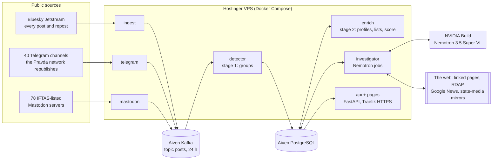

# Architecture

FactsLens runs as seven small Python services in one Docker Compose stack on a Hostinger VPS (2 vCPU, 8 GB RAM, no GPU). Aiven for Apache Kafka carries the event stream between them; Aiven for PostgreSQL holds everything a page or a report needs. NVIDIA Nemotron 3.5 Super VL (NVIDIA Build) does the reading, looking and reasoning.

## Services

| Service | Does | Memory limit |
|---|---|---|
| `ingest` | Reads Bluesky's Jetstream (posts and reposts, ~4,000 a minute), rotates between the four public servers when one stalls, resumes from a cursor stored in PostgreSQL, writes trimmed events to Kafka. | 512 MB |
| `telegram` | Every 5 minutes, reads the public pages (`t.me/s/…`) of the 40 Telegram channels the Pravda network republishes most (CheckFirst's data). Same event format, same Kafka topic. | 256 MB |
| `mastodon` | Every 5 minutes, reads the public timelines of the 78 Mastodon servers on IFTAS's Portal Kombat list. Skips accounts that are bridged and active on Bluesky (Jetstream has them). | 256 MB |
| `detector` | Stage 1. Consumes Kafka and keeps a 60-minute window in memory: near-identical text (MinHash), shared links and domains, the same hashtag set, the same fediverse server, repost rings; drops the second copy of a post seen on two platforms. Groups that pass a gate are stored as clusters. | 2 GB |
| `enrich` | Stage 2. Fetches profiles (Bluesky AppView, Mastodon servers), checks public lists (VIGINUM, CheckFirst, IFTAS), and scores each cluster with explainable signals in four categories: coordination, account, provenance, disclosure. Tiers: suspicious, watch, likely organic, declared bots. | 512 MB |
| `investigator` | Nemotron. Investigates suspicious and watch clusters (highest score first). Every 15 minutes writes a campaign report and compares up to two contested stories; every 5 minutes hashes new images and judges reused pictures. | 1 GB |
| `api` | Public pages (status, clusters, campaigns, stories, metrics) and reviewer mode (names, post texts, the review bar, translation). | 512 MB |

All services share one image (`Dockerfile`) and one package (`src/factslens`), each with its own entry point. Configuration comes from each person's own `.env`, which is never committed.

## Nemotron's jobs

| Job | Input | Output | Checks |
|---|---|---|---|
| Investigator + judge | Numbered evidence pack: posts (P), anonymised accounts (A), signals (S), full-size images (I), up to 2 min of video (V), linked pages (W). Tools: `fetch_page`, `domain_info`, `search_news` (Q searches, N articles). | Report: narrative, innocent explanation, reasons, verdict (staged / organic / insufficient evidence), techniques with exact quotes, source trust, media findings, a news check per claim. | Schema-enforced JSON with one repair round; every claim must cite ids it was shown; technique quotes must appear in the cited post; "staged" needs a grounded claim; "organic" is not allowed when documented-network evidence fired. |
| Campaign analyst | All clusters (≤ 40) that share accounts, with every account and the clusters it appears in. | One campaign or not, what it pushes, how it is run, accounts to review first. | Ids checked; "staged" needs a grounded finding. |
| Story analyst | State-media and Telegram headlines (H), independent coverage from several news editions (N), our matching clusters (S), photos and a video. | Versions, agreements, contradictions, claims only state media make, which clusters push which version. | Ids checked; "contested" needs a grounded contradiction. |
| Picture checker | One picture and the two captions it was posted with. | Which caption the picture fits, with visible clues. | Schema-enforced. |
| Red team (offline) | A brief per difficulty level. | Synthetic campaigns about a fictional country (`.example` links), replayed into recorded traffic. | Never posted; marked synthetic. |
| Translator (on request) | A cluster's posts. | English, keeping loaded words. | Kept in memory only. |

Every call is logged (purpose, latency, tokens, retries, errors) in `model_calls`. Each service keeps its own budget (20 calls a minute, 300 an hour) and retries with backoff; an error in a periodic round is logged and never stops the service.

## Data

**Kafka** (Aiven): one topic, `posts` (1 partition for time order, 2 replicas, 24 hours or 2 GiB).

**PostgreSQL** (Aiven), schema in `migrations/001–010`, applied on start:

| Table | Holds |
|---|---|
| `ingest_cursor`, `service_status` | Resume points and each service's latest report |
| `clusters`, `cluster_members`, `cluster_posts`, `accounts` | Candidate clusters, their accounts (keyed hash) and sample posts, profiles |
| `investigations`, `model_calls` | Nemotron reports with their evidence map, and every model call |
| `campaigns`, `stories`, `image_hashes`, `image_reuse` | Campaign reports, contested stories, picture hashes and judged reuses |
| `reviews`, `account_reviews` | Human decisions per cluster (with type) and per account |
| `eval_runs` | Red-team and documented-account results for the metrics page |

## Privacy and safety

- **Account ids at rest are keyed hashes** (HMAC with a secret in `.env`); a plain hash of a public id could be reversed by hashing the stream.
- **After 72 hours** raw ids, names, bios, post texts, the post ids inside investigations, campaign and story reports, and picture records are deleted (`common/store.py`); the detector runs this every hour.
- **Public pages show names and post texts only for already-public cases:** accounts on IFTAS's public list, accounts the platform removed, public Telegram channels. Everything else is for reviewers.
- **Nothing is ever posted.** Synthetic campaigns exist only in our Kafka topic and replays.
- **No automatic accusation:** every cluster, campaign and story is a lead for a human reviewer.

## Deployment

`infra/deploy.sh` packs the committed tree (`git archive`), copies it, the private `.env`, the Kafka CA certificate and the downloaded ground-truth lists to the VPS over SSH, runs `docker compose up -d --build`, and waits for `/health` over HTTPS. The VPS template's Traefik terminates TLS with Let's Encrypt; the `api` service registers through Docker labels. `infra/check_access.py` tests every integration (Bluesky, NVIDIA text/image/tools/video, Kafka, PostgreSQL, Hostinger API, SSH, the public URL).

## Evaluation

`python -m factslens.eval.run` replays a recorded window of real traffic with Nemotron's red-team campaigns mixed in, through the production detector and scoring. `python -m factslens.eval.report_quality` compares investigator versions on a fixed set of 12 live clusters. Results and their limits: [`EVAL.md`](EVAL.md); prompt and pipeline changes with their measured effect: [`IMPROVEMENTS.md`](IMPROVEMENTS.md).
